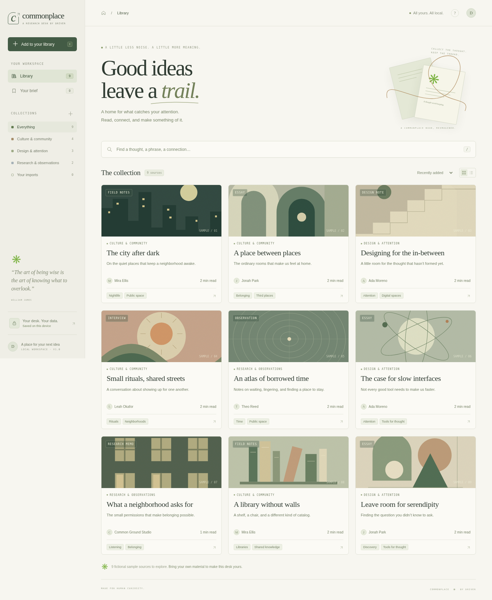

# Commonplace — Linux desktop edition

A private research desk. Read your documents, save exact passages with their sources, add notes, and export a brief.

## Open it on your Linux desktop

**You need only your existing, current web browser with JavaScript enabled. No npm, Node.js, Python, terminal commands, package installation, or server is required to use the app.**

1. **[Download Commonplace-portable.zip](https://github.com/Gizmo640/Driver-s_Repo/raw/refs/heads/main/artifacts/Commonplace-portable.zip)** and extract it using your file manager.
2. Put the extracted `Commonplace` folder somewhere permanent, such as `Documents/Commonplace`.
3. In your browser, press **Ctrl+O**, choose **`Commonplace.html`** from that folder, and open it. You can also right-click the file in your file manager and choose **Open With → your web browser**.
4. Bookmark the page if you want a quick way back. Internet access is not needed after downloading the app.

**If you already cloned or downloaded this repository:** open **`artifacts/Commonplace.html`** in your browser. It is already built and committed. Do not open the root `index.html`; that is a development source file, not the standalone app. Do not run a build command to use the portable edition.

The ZIP contains the application and `START-HERE.txt`. All code, styling, icons, illustrations, and sample documents are included in the HTML file. Nothing is fetched from another service. Your operating system and browser are the only prerequisites; they are not bundled.

## Use it with your own documents

1. Click **Add to your library**, or drag files from your Linux file manager onto the page. Supported formats: UTF-8 TXT, Markdown, CSV, and JSON. PDF is not supported.
2. Search for a phrase you know appears in a document. Put an exact phrase in double quotes. Separate search terms must all appear in a source.
3. Open a source and click **＋** beside a passage. Its exact text, title, author, and original line numbers are saved together.
4. Open **Your brief** and type your own note. Click the source title to return to the quoted paragraph.
5. Click **Export Markdown** to save the brief in your browser's download folder. Your notes are kept separate from the source's words.

Keyboard: **/** or **Ctrl+K** searches; **Escape** closes a source. The workspace supports desktop mouse and keyboard use. Save, reorder, and export actions can also be reached with Tab.

The nine starter sources are **fictional samples**, labeled in the app. Related-source suggestions show shared words; they are lexical comparisons, not AI conclusions or verification that sources agree.

## Keep your work safe

Your documents and notes are saved in this browser's local storage, not inside the HTML file. Keep the HTML file at the same path and use the same browser profile. Renaming or moving it, switching browsers, using private browsing, or clearing browser data can make that saved workspace unavailable. Local-file storage behavior varies by browser.

**Back up important work:** click **Your desk. Your data.** in the sidebar, then **Back up workspace as JSON**. Save the downloaded backup somewhere safe. To restore it, use **Add to your library** and select the backup JSON. Restore merges sources and passages; re-importing an unchanged backup skips existing items.

If browser storage is restricted or full, the app warns that changes are in memory. Export a backup before closing. Local storage is not encrypted, cloud sync, or automatic backup. Source text is limited to 2 MB per file and 8 MB total, subject to your browser's storage limit. Small libraries are best for a modest computer.

Removing a source preserves its saved quotes and notes; the missing original is marked in the brief. Source and quote removals offer a ten-second undo. Raw HTML in imported documents is displayed as text rather than executed.

## What was verified

The primary desktop workflow is tested in **Chromium on Linux**, using the exact standalone HTML without a development server or sibling files: imports, search, saving quotes, source line accuracy, notes, reload persistence, Markdown export, backup/restore, keyboard navigation, and safe handling of imported HTML.

This managed test browser blocks `file://` navigation by policy. The standalone file is therefore supplied at an intercepted local test URL, with no server process. Direct opening from the Linux file manager remains **unverified here**, as do Firefox and your particular browser profile. The app does not require a server; this is a limit on the test environment. If you encounter a file-opening error, report your browser and the exact error instead of installing developer tools.

There are also model/server tests and secondary small-screen layout checks. They are developer checks, not steps you need to perform to use the app.

## Working on the code

Optional development and test instructions are in **[DEVELOPING.md](DEVELOPING.md)**. They are separate from running the already-built Linux desktop app.
